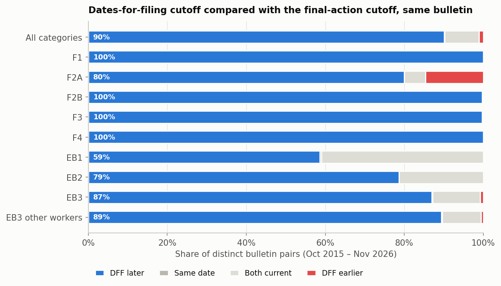
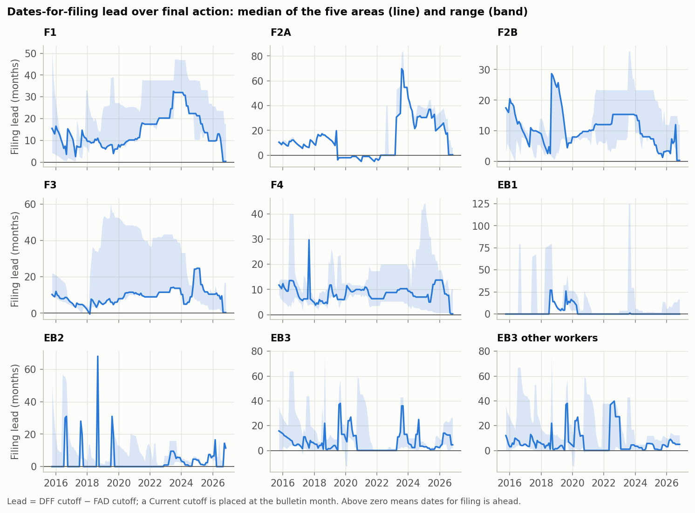
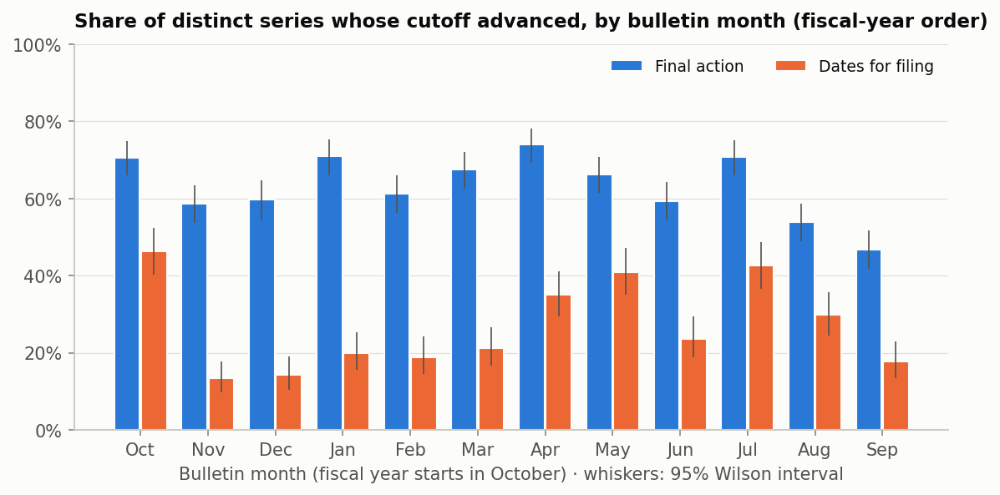
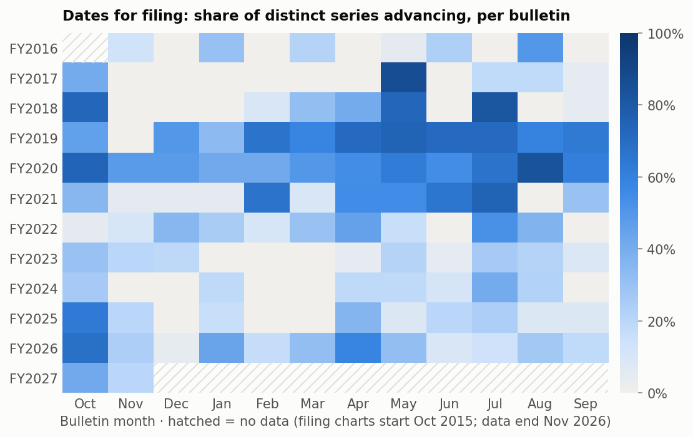
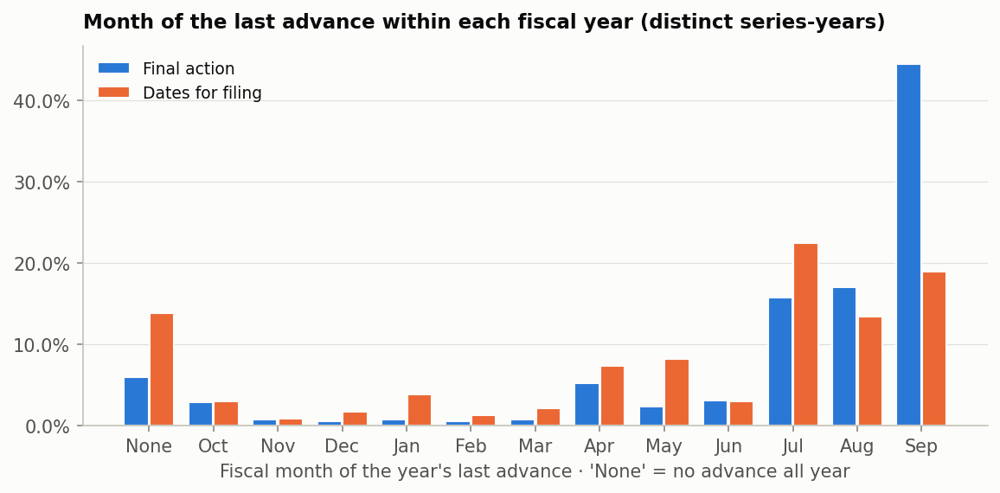

# Statement 1 — Dates for filing vs final action, and when dates for filing move

> *The date for filing cutoff date is usually ahead of the final action date and usually progresses only at
> the beginnings of each fiscal year. It usually stops progressing at the end of the fiscal years.*

The statement makes three separate claims, tested one at a time:

| Claim | Verdict | Evidence |
|---|---|---|
| **1a.** Dates for filing (DFF) is usually ahead of final action (FAD) | **Supported** | DFF is later than FAD in 90% of distinct pairs and earlier in only 1.1%. |
| **1b.** DFF usually progresses only at the beginning of the fiscal year | **Not supported** | October is the most likely month for DFF to advance, but only 15% of DFF advances happen in October and only 4% of moving series-years advance only then. |
| **1c.** DFF usually stops progressing at the end of the fiscal year | **Not supported** | 64% of moving series-years still advance in Jul–Sep, July is among the busiest months, and September (18%) is not significantly slower than mid-year. |

Data: 3,585 distinct DFF/FAD bulletin pairs and 3,045 distinct DFF month-over-month moves
(Oct 2015 – Nov 2026), across the categories and areas listed in the [method notes](../README.md#method).
"Distinct" means areas publishing the identical cutoff (for example Mexico and "all other areas" for most EB
categories) are counted once per bulletin.

## 1a. Dates for filing is ahead of final action

Across all distinct pairs, DFF is **later (ahead) in 90.1%**, identical or both Current in
8.8%, and **earlier in only 1.1%**.

- **No lead:** almost all of these are months when *both* charts were Current, mostly EB1 (41% of
  EB1 pairs) and EB2 (21%). A shared non-Current date is very rare
  (0.1%).
- **DFF earlier:** this is mostly F2A between Jul 2019 and Mar 2022
  (33 of 41 cases). In those months F2A *final action* was
  Current while the filing chart kept a date.
- **F1, F2B, F3, F4:** DFF is ahead in essentially every bulletin.

| Category          | Distinct pairs   | DFF later   | Same date   | Both current   | DFF earlier   | Median lead when both dated (months)   |
|:------------------|:-----------------|:------------|:------------|:---------------|:--------------|:---------------------------------------|
| F1                | 402              | 100.0%      | 0.0%        | 0.0%           | 0.0%          | 16.6                                   |
| F2A               | 225              | 80.0%       | 0.0%        | 5.3%           | 14.7%         | 15.6                                   |
| F2B               | 402              | 99.8%       | 0.2%        | 0.0%           | 0.0%          | 9.0                                    |
| F3                | 402              | 99.8%       | 0.0%        | 0.0%           | 0.2%          | 10.9                                   |
| F4                | 537              | 100.0%      | 0.0%        | 0.0%           | 0.0%          | 8.0                                    |
| EB1               | 271              | 58.7%       | 0.4%        | 41.0%          | 0.0%          | 5.3                                    |
| EB2               | 399              | 78.7%       | 0.0%        | 21.3%          | 0.0%          | 4.2                                    |
| EB3               | 476              | 87.0%       | 0.2%        | 12.0%          | 0.8%          | 7.0                                    |
| EB3 other workers | 471              | 89.4%       | 0.2%        | 9.8%           | 0.6%          | 7.0                                    |

The lead is not constant. It widens and narrows as the State Department moves the two charts. Apart from F2A
during 2019–2022, the median lead stays at or above zero. Two other features stand out:

- **Employment leads collapse to zero** when categories become Current in both charts.
- **Family leads shrink sharply from Sep 2026.** In the latest bulletins, the family filing dates sit only
  about 10 days ahead of final action (for example F1 "all other areas": 01FEB20 vs 22JAN20).

## 1b. Does DFF progress only at the beginning of the fiscal year?

October *is* special:

- It is the month in which DFF is most likely to advance.
- It carries 25.5% of all DFF forward movement, about three times the 8.3% expected if movement
  were spread evenly.
- It is also when most DFF retrogressions happen: 69% of
  all DFF retrogressions are in October.

But DFF also advances regularly in other months. The four most active are Oct (46%), Jul (43%), May (41%), Apr (35%), and only
14.5% of all DFF advances happen in October.

| Bulletin month   | DFF events   | DFF advance   | DFF hold   | DFF retrogress   | Share of all DFF forward movement   | FAD advance (reference)   |
|:-----------------|:-------------|:--------------|:-----------|:-----------------|:------------------------------------|:--------------------------|
| Oct              | 257          | 46.3%         | 44.0%      | 9.7%             | 25.5%                               | 70.7%                     |
| Nov              | 277          | 13.4%         | 85.6%      | 1.1%             | 5.2%                                | 58.7%                     |
| Dec              | 253          | 14.2%         | 85.0%      | 0.8%             | 5.2%                                | 59.8%                     |
| Jan              | 255          | 20.0%         | 78.8%      | 1.2%             | 5.9%                                | 70.9%                     |
| Feb              | 254          | 18.9%         | 80.7%      | 0.4%             | 2.6%                                | 61.2%                     |
| Mar              | 255          | 21.2%         | 78.8%      | 0.0%             | 6.2%                                | 67.5%                     |
| Apr              | 251          | 35.1%         | 64.9%      | 0.0%             | 8.8%                                | 73.9%                     |
| May              | 249          | 41.0%         | 58.2%      | 0.8%             | 11.1%                               | 66.3%                     |
| Jun              | 249          | 23.7%         | 76.3%      | 0.0%             | 5.1%                                | 59.4%                     |
| Jul              | 249          | 42.6%         | 57.4%      | 0.0%             | 9.1%                                | 70.8%                     |
| Aug              | 248          | 29.8%         | 70.2%      | 0.0%             | 10.5%                               | 53.8%                     |
| Sep              | 248          | 17.7%         | 82.3%      | 0.0%             | 4.8%                                | 46.8%                     |

Looking at each series one fiscal year at a time makes the same point. Among series-years in which DFF moved at
all, **3.5% advanced only in October**, and 6.5% advanced only in fiscal Q1. October
was part of the year's movement in 55.0% of them.

| Measure (DFF, distinct series-years FY2017–FY2026)          | Value   |
|:------------------------------------------------------------|:--------|
| Series-years                                                | 232     |
| No advance at all during the year                           | 13.8%   |
| Median advancing bulletins per year (years with ≥1 advance) | 3 of 12 |
| Advanced in October (years with ≥1 advance)                 | 55.0%   |
| Advanced **only** in October                                | 3.5%    |
| Advanced only in Oct–Dec (fiscal Q1)                        | 6.5%    |
| Last advance in Jul–Sep (fiscal Q4)                         | 63.5%   |
| Last advance in September                                   | 22.0%   |

The heatmap shows that DFF movement varies a lot from year to year:

- **October is dark in many years** (FY2017–FY2020, FY2025–FY2026) but quiet in FY2022–FY2024.
- **FY2019–FY2021 advanced through most of the year.**
- **Several years have their busiest bulletin in spring or summer,** for example May in FY2017 and Jul in FY2018.

## 1c. Does DFF stop progressing at the end of the fiscal year?

The least active DFF months are Nov (13%), Dec (14%), Sep (18%): the two months right after October, plus September.

- **September** is slightly slower than mid-year (Nov–Jun), but the difference is not statistically
  distinguishable (table below).
- **July and August** are among the more active DFF months.
- **63.5% of moving series-years make their last advance in fiscal Q4** (Jul–Sep), and
  22.0% advance in the very last bulletin, September. Final action does this even more
  (82.1% last advance in Q4).

The tests treat each bulletin as one observation (the share of distinct series that advanced), because the
series in one bulletin are set together and are not independent:

| Comparison (DFF bulletins)     | Bulletins   | Mean share advancing   | Mann–Whitney p   |
|:-------------------------------|:------------|:-----------------------|:-----------------|
| October vs all other months    | 11 vs 122   | 46% vs 25%             | 0.006            |
| Jul–Sep (fiscal Q4) vs Nov–Jun | 33 vs 89    | 30% vs 23%             | 0.194            |
| September vs Nov–Jun           | 11 vs 89    | 18% vs 23%             | 0.482            |

## Conclusion

- **DFF ahead of FAD: yes.** This is the most robust part of the statement.
- **DFF moves "only" at the start of the fiscal year: no.** October is the single biggest month for DFF
  movement, but most DFF movement happens in other bulletins, especially Apr, May and Jul.
- **DFF stops at the end of the fiscal year: no.** Most moving series-years still advance in Jul–Sep, and
  September is not significantly quieter than mid-year. The real lull is November–December, right after the
  October reset.

## Caveats

- DFF charts begin in October 2015, so there are only 10 complete fiscal years of DFF data (FY2017–FY2026).
- USCIS decides each month which chart applies to adjustment-of-status filings. This analysis looks at the
  published cutoffs only.
- A move to or from Current counts as an advance or retrogression. Its size uses the bulletin month as the
  effective cutoff (the dashboard's convention), so tables of distances use date-to-date moves only.
