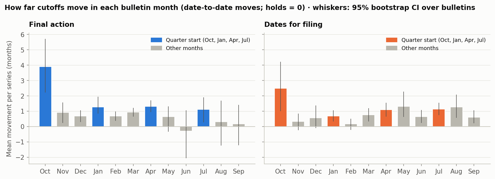
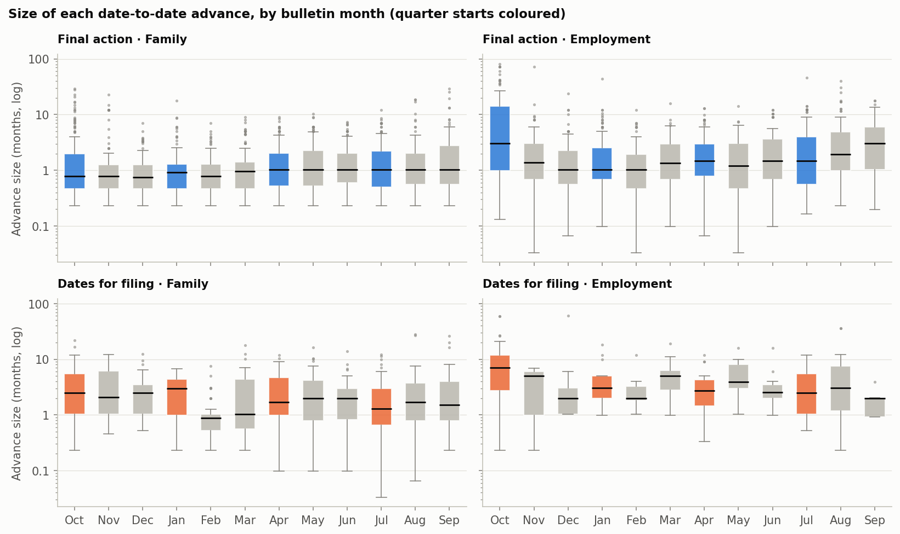
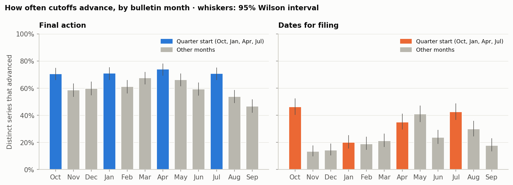
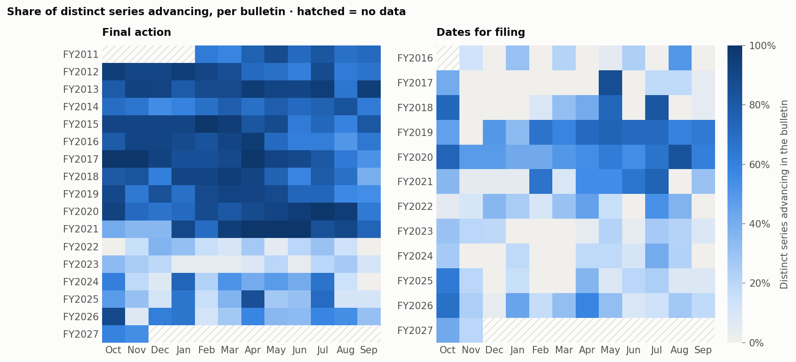

# Statement 2 — Fiscal-year leaps and quarter-start advances

> *Both date for filing and final action dates usually leap forward by a lot at the beginning of a fiscal year
> and more likely to move forward at the beginning of each quarter.*

| Claim | Verdict | Evidence |
|---|---|---|
| **2a.** Both charts leap forward by a lot at the start of the fiscal year (October bulletin) | **Partly supported** | October carries 24% (FAD) and 25% (DFF) of all forward movement, and FAD moves 3.9 vs 0.7 months per series. The leap is an employment effect; family final action does not jump in October. |
| **2b.** Both charts are more likely to advance at the start of each quarter | **Supported, mainly since FY2022** | Jan/Apr/Jul bulletins advance more often than non-quarter months: FAD 72% vs 60% (p = 0.023), DFF 32% vs 22% (p = 0.044). The gap is large from FY2022 on (FAD 47% vs 23%) and weak before. |

Data: 7,578 distinct month-over-month moves: final action Feb 2011 – Nov 2026 and dates for filing
Nov 2015 – Nov 2026. See the [method notes](../README.md#method).

The State Department fiscal year starts on October 1, and annual visa numbers reset then. Quarters start in
October, January, April and July. Each bulletin is treated as one observation in the tests, because all series
in a bulletin are set together.

## 2a. Leaps at the start of the fiscal year

October is not unusual for *how often* final action advances. 69% of series advance in an
average October, against 63% in other months (p = 0.437). What changes is *how
far* they move:

- **Final action** moves on average **3.9 months per series in October**, against 0.7 in
  other months (p = < 0.001).
- **Dates for filing** moves **2.5 vs 0.8 months**. That gap is not significant with only
  11 October bulletins (p = 0.101). However, DFF is clearly more *likely* to advance in October:
  46% vs 25% (p = 0.006).
- **October alone carries 23.9% of all final-action forward movement** and
  25.5% of dates-for-filing movement, roughly three times the 8.3% expected from
  one month in twelve.

The leap is concentrated in **employment** categories:

- Employment final action: the median October advance is 3.0 months,
  against 1.2 in other months.
- Employment dates for filing: 7.0 vs
  3.0.
- Family final action has **no** October leap: 0.8 vs
  1.0. Family cutoffs mostly creep forward about a month
  at a time, in most bulletins.

| Chart            | Preference   | Advancing · Oct   | Advancing · Jan/Apr/Jul   | Advancing · Other months   | Median advance (mo) · Oct   | Median advance (mo) · Jan/Apr/Jul   | Median advance (mo) · Other months   |
|:-----------------|:-------------|:------------------|:--------------------------|:---------------------------|:----------------------------|:------------------------------------|:-------------------------------------|
| Final action     | Family       | 68%               | 72%                       | 61%                        | 0.8                         | 1.0                                 | 1.0                                  |
| Final action     | Employment   | 74%               | 72%                       | 57%                        | 3.0                         | 1.3                                 | 1.2                                  |
| Dates for filing | Family       | 37%               | 38%                       | 28%                        | 2.5                         | 1.8                                 | 1.5                                  |
| Dates for filing | Employment   | 60%               | 24%                       | 13%                        | 7.0                         | 3.0                                 | 3.0                                  |

## 2b. Advances at the start of each quarter

On both charts, the quarter-start bulletins (Jan, Apr, Jul) advance more often than non-quarter months:

- **Final action:** October has a similar advance rate to the other quarter starts, and the two weakest months
  are the last two of the fiscal year (Aug, Sep), when annual limits bind.
- **Dates for filing:** the pattern is noisier. May is as active as the quarter starts, while January is
  quiet.

| Chart            | Metric                        | Comparison                        | Bulletins   | Mean         | Mann–Whitney p   |
|:-----------------|:------------------------------|:----------------------------------|:------------|:-------------|:-----------------|
| Final action     | Share of series advancing     | Oct vs all other months           | 16 vs 174   | 69% vs 63%   | 0.437            |
| Final action     | Share of series advancing     | Jan/Apr/Jul vs non-quarter months | 47 vs 127   | 72% vs 60%   | 0.023            |
| Final action     | Mean move per series (months) | Oct vs all other months           | 16 vs 174   | 3.90 vs 0.71 | < 0.001          |
| Final action     | Mean move per series (months) | Jan/Apr/Jul vs non-quarter months | 47 vs 127   | 1.24 vs 0.51 | 0.024            |
| Dates for filing | Share of series advancing     | Oct vs all other months           | 11 vs 122   | 46% vs 25%   | 0.006            |
| Dates for filing | Share of series advancing     | Jan/Apr/Jul vs non-quarter months | 33 vs 89    | 32% vs 22%   | 0.044            |
| Dates for filing | Mean move per series (months) | Oct vs all other months           | 11 vs 122   | 2.50 vs 0.78 | 0.101            |
| Dates for filing | Mean move per series (months) | Jan/Apr/Jul vs non-quarter months | 33 vs 89    | 0.97 vs 0.71 | 0.037            |

| Bulletin month   | Quarter start   | FAD advancing   | FAD mean move (mo)   | FAD share of forward movement   | DFF advancing   | DFF mean move (mo)   | DFF share of forward movement   |
|:-----------------|:----------------|:----------------|:---------------------|:--------------------------------|:----------------|:---------------------|:--------------------------------|
| Oct              | yes             | 69%             | 3.90                 | 23.9%                           | 46%             | 2.50                 | 25.5%                           |
| Nov              |                 | 58%             | 0.93                 | 7.0%                            | 13%             | 0.33                 | 5.2%                            |
| Dec              |                 | 60%             | 0.69                 | 4.6%                            | 15%             | 0.57                 | 5.2%                            |
| Jan              | yes             | 71%             | 1.28                 | 6.8%                            | 19%             | 0.68                 | 5.9%                            |
| Feb              |                 | 61%             | 0.68                 | 4.4%                            | 19%             | 0.18                 | 2.6%                            |
| Mar              |                 | 67%             | 0.93                 | 6.1%                            | 21%             | 0.77                 | 6.2%                            |
| Apr              | yes             | 74%             | 1.32                 | 7.8%                            | 35%             | 1.10                 | 8.8%                            |
| May              |                 | 67%             | 0.65                 | 6.7%                            | 41%             | 1.31                 | 11.1%                           |
| Jun              |                 | 60%             | -0.29                | 6.6%                            | 23%             | 0.64                 | 5.1%                            |
| Jul              | yes             | 71%             | 1.12                 | 9.3%                            | 43%             | 1.14                 | 9.1%                            |
| Aug              |                 | 55%             | 0.30                 | 8.8%                            | 30%             | 1.28                 | 10.5%                           |
| Sep              |                 | 49%             | 0.18                 | 8.0%                            | 18%             | 0.60                 | 4.8%                            |

### The quarter effect is mostly a post-FY2022 pattern

The heatmaps show a regime change in final action:

- **Through FY2021**, most series advanced in almost every bulletin, so there was little room for quarter
  starts to stand out.
- **From FY2022**, movement became much sparser, and the Oct/Jan/Apr/Jul columns stand out (with exceptions
  such as May in FY2025).

Splitting the bulletins at FY2022 confirms this:

- **Final action:** quarter-start bulletins advance 47% vs 23% from FY2022
  (p = 0.001), against 83% vs 77% before (p = 0.090).
- **Dates for filing:** 28% vs 13% from FY2022 (p = 0.003), against
  36% vs 31% before (p = 0.575).

The October leap in movement size appears in both eras.

| Chart            | Era           | Bulletins (Jan/Apr/Jul vs other)   | Advancing: Oct   | Advancing: Jan/Apr/Jul vs other   | p (advancing)   | Mean move (mo): Oct   | Mean move (mo): Jan/Apr/Jul vs other   | p (move)   |
|:-----------------|:--------------|:-----------------------------------|:-----------------|:----------------------------------|:----------------|:----------------------|:---------------------------------------|:-----------|
| Final action     | FY2011–FY2021 | 32 vs 86                           | 82%              | 83% vs 77%                        | 0.090           | 4.62                  | 1.31 vs 0.56                           | 0.280      |
| Final action     | FY2022–FY2027 | 15 vs 41                           | 48%              | 47% vs 23%                        | 0.001           | 2.70                  | 1.08 vs 0.41                           | 0.038      |
| Dates for filing | FY2016–FY2021 | 18 vs 48                           | 54%              | 36% vs 31%                        | 0.575           | 3.17                  | 1.05 vs 0.90                           | 0.340      |
| Dates for filing | FY2022–FY2027 | 15 vs 41                           | 39%              | 28% vs 13%                        | 0.003           | 1.95                  | 0.87 vs 0.48                           | 0.011      |

## Conclusion

- **Fiscal-year leap: partly true.** October brings the largest moves of the year for *employment* cutoffs on
  both charts, and for dates for filing it is also the month most likely to move. It is not a "leap" for
  family final action, which advances by about the same small amount in most months.
- **Quarter-start advances: true, mainly since FY2022.** Over the whole period, quarter-start bulletins
  advance 10–12 percentage points more often than other months on both charts. The gap comes almost entirely
  from FY2022 onward, when movement became sparse and roughly doubled at quarter starts. Before that it was
  weak or absent. May, for dates for filing, is the main exception.

## Caveats

- There are only 11–16 bulletins per calendar month, so per-month estimates are noisy (see the whiskers).
- Size statistics use date-to-date moves only. A jump to Current counts as an advance but has no defined size.
- Retrogressions count as negative movement. Final-action retrogressions cluster in Jun–Sep, when annual
  limits bind, which pulls those months' means down; for example, the June mean is negative. Dates-for-filing
  retrogressions cluster in October.
