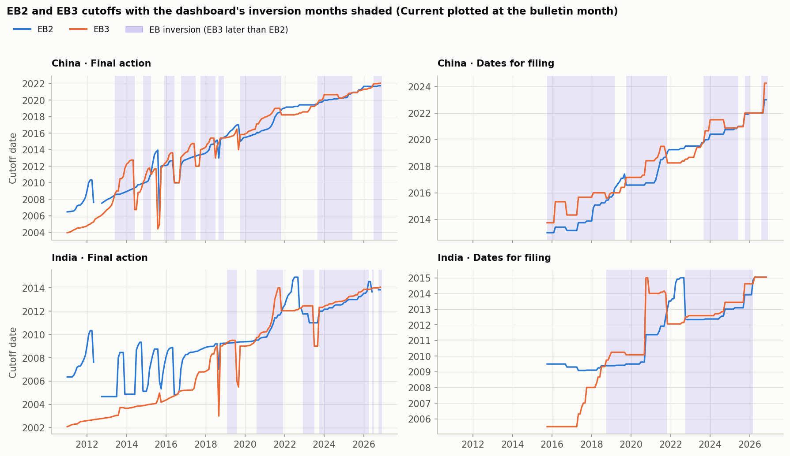
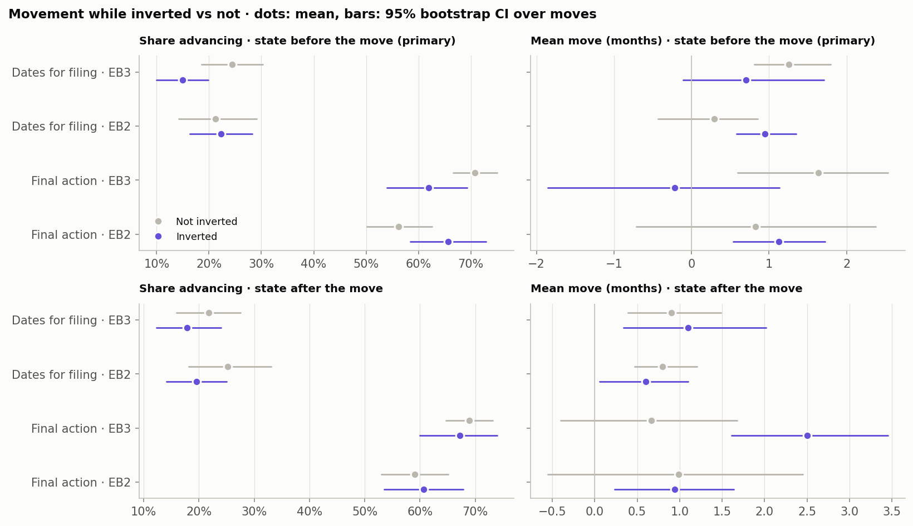
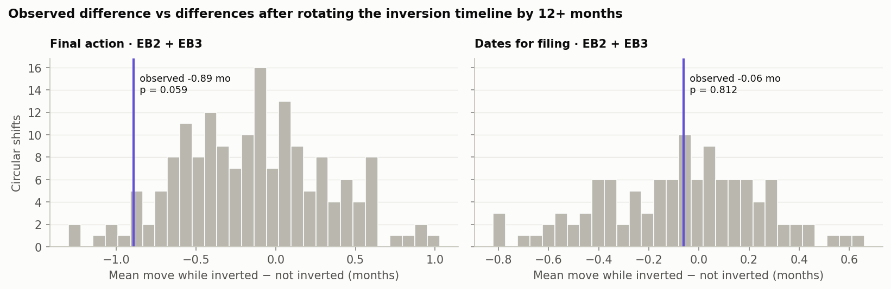

# Statement 3 — Do cutoffs move faster during an EB2/EB3 inversion?

> *Cutoff dates tend to move more quickly when there is EB2 EB3 inversion (as computed in the code).*

| Claim | Verdict | Evidence |
|---|---|---|
| **3.** EB cutoffs move faster while EB3 is ahead of EB2 | **Not supported** | While inverted, EB2 + EB3 final-action cutoffs move 0.46 months per bulletin vs 1.35 otherwise (slower, borderline p = 0.059); dates for filing shows no difference (0.83 vs 0.89). |

## What counts as an inversion

Inversion months come straight from the dashboard's `shading.inversion_intervals()`:

- **Inverted:** for a given chart type and area, EB3's cutoff is strictly later than EB2's, or EB3 is Current
  while EB2 has a date.
- **Not inverted:** both Current, equal dates, or missing/unavailable cutoffs.

Inversions are concentrated in China and India. The other three areas had only a few short episodes
(2016–2018 and 2022–2024):

| Area            | Final action   | Dates for filing   |
|:----------------|:---------------|:-------------------|
| All other areas | 12             | 13                 |
| China           | 95             | 94                 |
| India           | 62             | 78                 |
| Mexico          | 12             | 13                 |
| Philippines     | 9              | 10                 |

*Inverted bulletin months, out of 191 final-action and 134
dates-for-filing bulletins.*

## How speed is measured

- **Moves:** each month-over-month change in the EB2 and EB3 cutoffs of the five areas.
- **Metrics:** the share of moves that advance (including jumps to Current) and the mean and median size of
  date-to-date moves in months. Holds count as 0 and retrogressions as negative.
- **Labeling:** a move is "inverted" if the inversion existed in the bulletin **before** the move, i.e. the
  move was made while the inversion was in place. Labeling by the bulletin **after** the move is shown as a
  sensitivity check; it mechanically counts the jump that *creates* an inversion as "inverted" movement.
- **Collapsing:** areas with the identical move and inversion label in a bulletin (usually "all other
  areas" and Mexico) count once.
- **Significance:** a circular-shift test. The inversion timeline is rotated by 12 or more months and the
  difference recomputed, which keeps the long runs of inversion months intact. An ordinary test would treat
  each month as independent and overstate significance.

## Result: cutoffs do not move faster while inverted

Using the inversion state before the move:

| Chart            | Category   | Moves (inverted / not)   | Advancing: inverted vs not   | Mean move (mo): inverted vs not   | Median move (mo): inverted vs not   | Shift-test p (mean move)   | Shift-test p (advancing)   |
|:-----------------|:-----------|:-------------------------|:-----------------------------|:----------------------------------|:------------------------------------|:---------------------------|:---------------------------|
| Final action     | EB2        | 166 / 251                | 66% vs 56%                   | 1.13 vs 0.82                      | 0.69 vs 0.23                        | 0.657                      | 0.479                      |
| Final action     | EB3        | 163 / 452                | 62% vs 71%                   | -0.22 vs 1.63                     | 0.69 vs 0.69                        | 0.012                      | 0.201                      |
| Final action     | EB2 + EB3  | 329 / 703                | 64% vs 66%                   | 0.46 vs 1.35                      | 0.69 vs 0.56                        | 0.059                      | 0.846                      |
| Dates for filing | EB2        | 184 / 127                | 22% vs 21%                   | 0.95 vs 0.29                      | 0.00 vs 0.00                        | 0.089                      | 0.920                      |
| Dates for filing | EB3        | 181 / 205                | 15% vs 24%                   | 0.70 vs 1.26                      | 0.00 vs 0.00                        | 0.170                      | 0.018                      |
| Dates for filing | EB2 + EB3  | 365 / 332                | 19% vs 23%                   | 0.83 vs 0.89                      | 0.00 vs 0.00                        | 0.812                      | 0.241                      |

**Final action**

- **EB3 stalls or retrogresses** while ahead of EB2: mean move
  -0.22 vs 1.63 months
  (p = 0.012).
- **EB2 moves a little more** while behind (1.13 vs
  0.82; p = 0.657, not significant).
- **Pooled, the cutoffs move slower, not faster:** 0.46 vs
  1.35 months per move (borderline, p = 0.059).

**Dates for filing**

- **Pooled, no difference:** 0.83 vs
  0.89 (p = 0.812).
- **EB3 advances less often** while inverted: 15% vs
  24% (p = 0.018).

By area, final action moves slower while inverted in every area. Dates for filing moves slightly faster in
China and India and slower in the three areas with only brief inversions:

| Chart            | Area            | Inverted months   | Moves (inverted / not)   | Advancing: inverted vs not   | Mean move (mo): inverted vs not   |
|:-----------------|:----------------|:------------------|:-------------------------|:-----------------------------|:----------------------------------|
| Final action     | All other areas | 12                | 18 / 176                 | 39% vs 62%                   | -0.07 vs 1.76                     |
| Final action     | China           | 95                | 188 / 187                | 71% vs 63%                   | 0.62 vs 1.53                      |
| Final action     | India           | 62                | 121 / 250                | 56% vs 65%                   | 0.18 vs 0.98                      |
| Final action     | Mexico          | 12                | 18 / 176                 | 39% vs 62%                   | -0.07 vs 1.91                     |
| Final action     | Philippines     | 9                 | 14 / 203                 | 29% vs 67%                   | 0.71 vs 1.56                      |
| Dates for filing | All other areas | 13                | 22 / 73                  | 14% vs 25%                   | -0.02 vs 0.78                     |
| Dates for filing | China           | 94                | 186 / 80                 | 21% vs 26%                   | 0.96 vs 0.85                      |
| Dates for filing | India           | 78                | 156 / 110                | 17% vs 18%                   | 0.81 vs 0.49                      |
| Dates for filing | Mexico          | 13                | 22 / 73                  | 14% vs 25%                   | -0.02 vs 0.78                     |
| Dates for filing | Philippines     | 10                | 16 / 124                 | 12% vs 25%                   | -0.19 vs 1.33                     |

*Per-area moves are not collapsed across areas.*

## Why the opposite labeling looks "faster"

With the state *after* the move, EB3 final action appears to move much faster while inverted:
2.50 vs 0.66 months
(p = 0.012). That comes from how inversions start and end:

| Bulletin         | Episodes   | EB3 advanced   | EB2 retrogressed   | EB2 advanced   | EB3 retrogressed   |
|:-----------------|:-----------|:---------------|:-------------------|:---------------|:-------------------|
| Inversion starts | 36         | 25             | 14                 | 10             | 3                  |
| Inversion ends   | 36         | 10             | 1                  | 27             | 14                 |

- **Starts:** most inversions begin with an EB3 advance, often together with an EB2 retrogression.
  Labeling by the state after the move counts that jump as movement "during" the inversion.
- **Ends:** most inversions end with EB2 advancing, sometimes with EB3 retrogressing.

In other words, an inversion is the *result* of a fast EB3 move, not a period of faster movement. Once
inverted, EB3 tends to stall and EB2 tends to catch up.

| Chart            | Category   | Moves (inverted / not)   | Advancing: inverted vs not   | Mean move (mo): inverted vs not   | Median move (mo): inverted vs not   | Shift-test p (mean move)   | Shift-test p (advancing)   |
|:-----------------|:-----------|:-------------------------|:-----------------------------|:----------------------------------|:------------------------------------|:---------------------------|:---------------------------|
| Final action     | EB2        | 168 / 249                | 61% vs 59%                   | 0.94 vs 0.99                      | 0.62 vs 0.33                        | 0.947                      | 0.917                      |
| Final action     | EB3        | 165 / 451                | 67% vs 69%                   | 2.50 vs 0.66                      | 0.99 vs 0.56                        | 0.012                      | 0.834                      |
| Final action     | EB2 + EB3  | 333 / 700                | 64% vs 65%                   | 1.72 vs 0.78                      | 0.77 vs 0.54                        | 0.047                      | 0.882                      |
| Dates for filing | EB2        | 184 / 127                | 20% vs 25%                   | 0.60 vs 0.80                      | 0.00 vs 0.00                        | 0.616                      | 0.375                      |
| Dates for filing | EB3        | 179 / 207                | 18% vs 22%                   | 1.10 vs 0.90                      | 0.00 vs 0.00                        | 0.679                      | 0.393                      |
| Dates for filing | EB2 + EB3  | 363 / 334                | 19% vs 23%                   | 0.85 vs 0.86                      | 0.00 vs 0.00                        | 0.973                      | 0.268                      |

## Conclusion

**Not supported.** While EB3 is ahead of EB2, neither chart's EB cutoffs move faster. Final-action cutoffs
move *slower* on average, mainly because EB3 stalls or retrogresses. Dates for filing shows no difference.
The impression of faster movement comes from the large EB3 jump that creates each inversion.

## Caveats

- There are only 36 inversion episodes across both charts and five areas, mostly in China and
  India, so per-category estimates are noisy.
- The inversion rule compares EB3 with EB2 only, not EB3 other workers, matching the dashboard.
- Mean moves are sensitive to a few very large jumps and retrogressions. Medians are shown alongside means
  in the tables.
