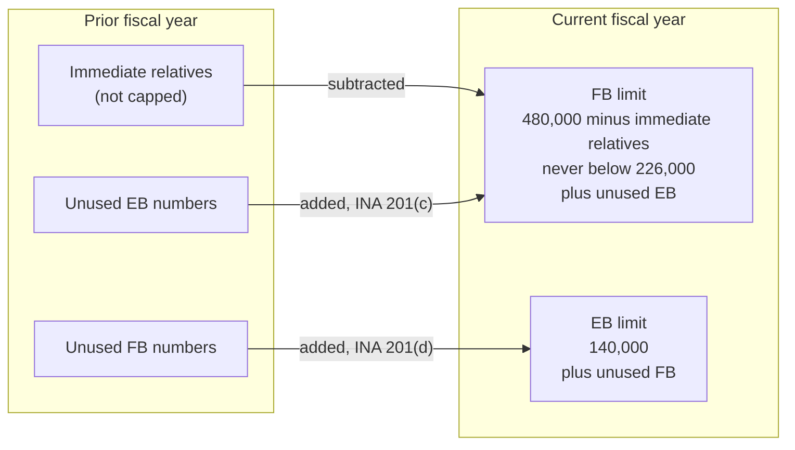
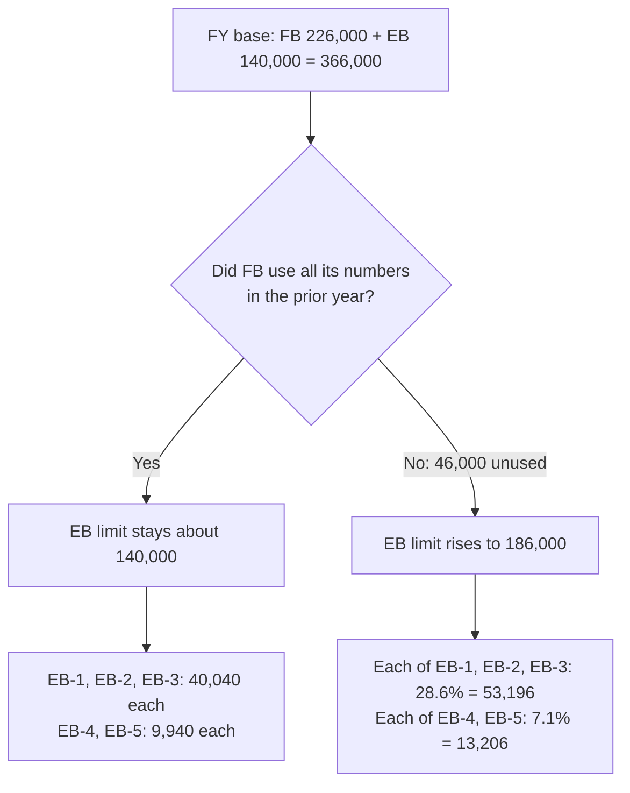

# Step 1 — The annual FB and EB limits

Each fiscal year (October 1 – September 30) has two separate worldwide limits. They are linked: unused numbers
of one flow into the other the next year.

## Family-sponsored (FB), INA 201(c)

- **Formula:** 480,000, minus the prior year's immediate relatives (and certain parolee and
  cancellation-of-removal adjustments), plus unused prior-year employment numbers.
- **Floor:** the result can never be below **226,000**.
- **In practice:** immediate relatives exceed 254,000 a year, so the formula always lands at the floor and the
  FB limit is **226,000**.

## Employment-based (EB), INA 201(d)

- **Formula:** 140,000 plus unused family-sponsored numbers from the prior fiscal year.
- **Result:** unlike FB, the limit moves every year.

| Fiscal year | EB limit | How it arises |
|---|---|---|
| FY2006 | 143,949 | 140,000 + 3,949 unused FY2005 FB numbers |
| FY2022 | 281,507 | Large FB carryover during the pandemic (reported figure) |
| FY2023 | 197,091 | Smaller carryover |
| FY2024 | 160,791 | Smaller still |

The FY2022 figure is reported by secondary sources and was not retrieved from a primary page. FY2023 is from
the USCIS FAQ and FY2006 and FY2024 match DoS documents.

## Worked example

The 186,000 case is illustrative and the 46,000 shortfall is invented for the example. Only the arithmetic,
not the scenario, is a fact.

## Why this matters for the cutoff dates

- A **larger EB limit** means more numbers per category, which lets cutoff dates advance faster.
- A year with **no FB carryover** brings EB back to about 140,000, which can cause stalls or retrogression.

Sources: [8 U.S.C. § 1151](https://www.law.cornell.edu/uscode/text/8/1151),
[USCIS FY2023 EB FAQs](https://www.uscis.gov/green-card/green-card-processes-and-procedures/fiscal-year-2023-employment-based-adjustment-of-status-faqs),
[Immigration Road](https://immigrationroad.com/visa-bulletin/immigrant-visa-annual-limit-and-cap.php).
