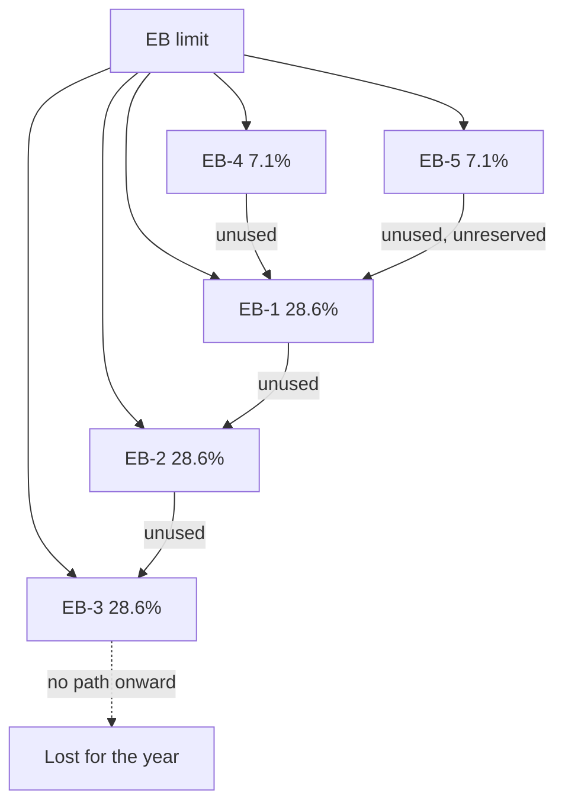
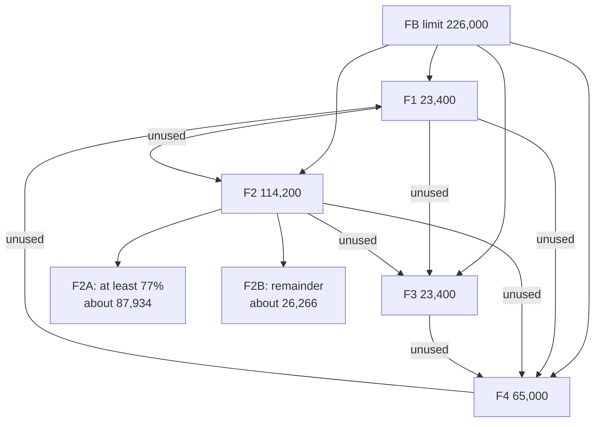

# Step 2 — Splitting each limit among the preference categories

Both splits are fixed by [8 U.S.C. § 1153](https://www.law.cornell.edu/uscode/text/8/1153) (INA 203). Both pass
**unused numbers** between categories during the same fiscal year, but in different directions.

## Employment-based (INA 203(b)): percentages of the EB limit

| Category | Who | Share of EB limit | Receives unused numbers from |
|---|---|---|---|
| EB-1 | Priority workers | 28.6% | EB-4 and EB-5 |
| EB-2 | Advanced degrees, exceptional ability | 28.6% | EB-1 |
| EB-3 | Skilled workers, professionals, other workers | 28.6% | EB-1 and EB-2 (EB-3 "other workers" capped at 10,000) |
| EB-4 | Special immigrants | 7.1% | none (it gives to EB-1) |
| EB-5 | Investors | 7.1% | none (it gives to EB-1) |

Two consequences:

- Unused EB-1 numbers can reach EB-3 only by passing through EB-2.
- **Nothing flows upward.** Unused EB-3 numbers cannot help EB-2, and there is no path back to EB-1. This is the
  structural reason an EB-3 cutoff can be later than the EB-2 cutoff for the same country (the "inversion").

**EB-5 set-asides** (statute, 203(b)(5)(B)): 20% of EB-5 is reserved for rural investors, 10% for high-unemployment
areas and 2% for infrastructure projects. An unused set-aside stays in its own category for the next fiscal year
and is released to the general EB-5 pool after that.

## Family-sponsored (INA 203(a)): fixed base numbers

| Category | Who | Base numbers | Plus unused from |
|---|---|---|---|
| F1 | Unmarried sons and daughters of citizens | 23,400 | F4 |
| F2 | Spouses and unmarried children of permanent residents | 114,200 (plus any amount the FB limit exceeds 226,000) | F1 |
| F3 | Married sons and daughters of citizens | 23,400 | F1 and F2 |
| F4 | Brothers and sisters of citizens | 65,000 | F1, F2 and F3 |

- **Base numbers add up:** 23,400 + 114,200 + 23,400 + 65,000 = 226,000.
- **F2A and F2B:** the statute says "not less than 77 percent" of F2 goes to spouses and children (F2A). The
  dollar figures are arithmetic from that, not stated in the statute: 77% of 114,200 is 87,934 and the
  remaining 23% is 26,266.
- **Direction is the reverse of EB:** unused numbers fall from higher-priority categories to lower ones
  (F1 to F2 to F3 to F4), and F4's unused numbers return to F1.

An earlier web source gave per-category figures that did not add up (for example 21,984 for F2A), and the
verification step rejected them. The numbers above come from the statute text.

## Why this matters for the cutoff dates

- Each category is a separate queue with its own supply, so cutoff dates differ by category even for the same
  country.
- Categories with little demand relative to supply (EB-1 outside China and India) stay "Current" and pass their
  leftovers down the ladder, which is what moves EB-2 and EB-3 cutoffs forward in strong years.

Sources: [8 U.S.C. § 1153](https://www.law.cornell.edu/uscode/text/8/1153),
[USCIS FY2023 EB FAQs](https://www.uscis.gov/green-card/green-card-processes-and-procedures/fiscal-year-2023-employment-based-adjustment-of-status-faqs).
