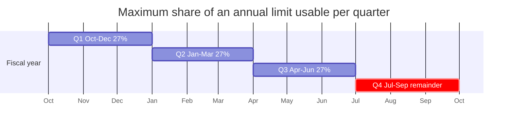
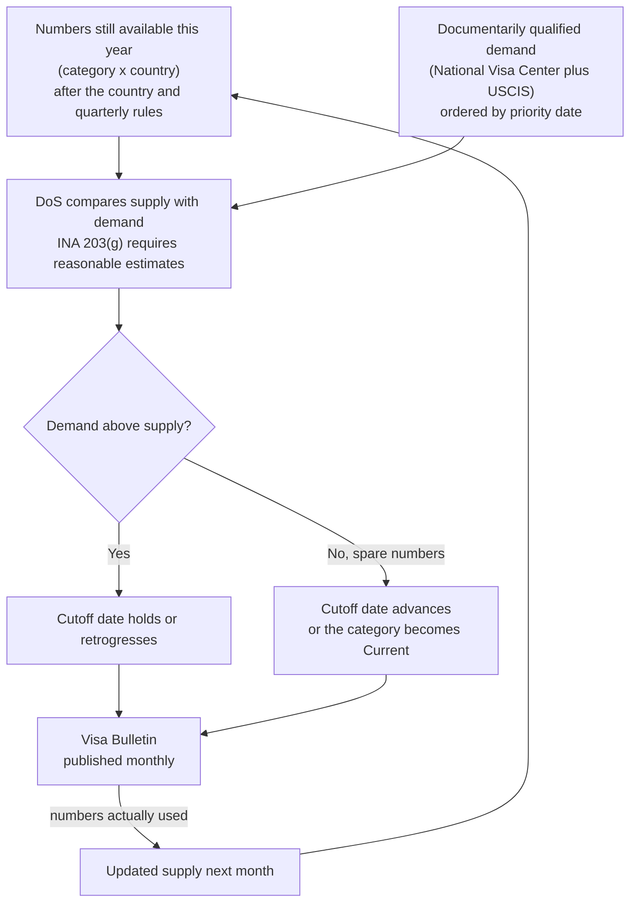

# Step 3 — Country cap, quarterly limit and the monthly cutoff dates

After the category limits are set, three more rules decide how many numbers are available to an applicant of a
given country at a given time. DoS then publishes the result as cutoff dates.

## Rule 1 — The 7% per-country cap (INA 202(a)(2))

- **What it caps:** one country's share of the **combined** FB and EB limits, not of each category. On a
  366,000 baseline (226,000 FB + 140,000 EB) that is **25,620**. Dependent areas are held to 2%.
- **Why some countries have their own columns in the bulletin:** these are countries whose demand exceeds their
  share in some categories, so their cutoff dates differ from the "all other areas" column.
- **Exceptions:**
  - When a category has more numbers in a quarter than qualified applicants, the excess is issued without regard
    to the country cap (INA 202(a)(5)(A), employment categories only).
  - For F2A, 75% of the numbers are exempt from the country cap (INA 202(a)(4), not retrieved in this research).

The split of the 25,620 into 15,820 FB and 9,800 EB seen on some pages is an arithmetic illustration, not a
statutory allocation.

## Rule 2 — The quarterly limit

DoS guidance limits use of an annual limit to **27% in each of the first three quarters** (Oct–Dec, Jan–Mar,
Apr–Jun), so the remainder is held for July–September. The rule applies to family, employment and diversity
numbers.

This rule is cited from secondary sources and DoS practice. The research could not tie it to a specific INA
subsection, and a claim that it sits in INA 201(a)(2) was refuted, so the report does not cite one.

## Rule 3 — Cutoff dates from supply and demand (INA 203(g))

DoS cannot issue more visas than a category's numbers allow, so it controls the **queue** by priority date.

- **When a number is "used":** when a visa is issued or the applicant becomes a permanent resident, not when an
  application is filed or an interview is scheduled.
- **Why dates retrogress:** estimates can be wrong. If demand arrives faster than expected, DoS holds or moves
  the date back. The bulletin has no legal publication deadline.

## Two charts: Final Action Dates vs Dates for Filing

| Chart | Meaning | Who uses it |
|---|---|---|
| **Final Action Dates** | A number is available: a visa can be issued only for earlier priority dates | Consular processing always; USCIS approvals |
| **Dates for Filing** | Earliest point to submit adjustment-of-status paperwork | USCIS, only when it says so for that month |

USCIS decides each month which chart applies to adjustment applicants. It tells applicants to use Dates for
Filing when more visas are available than known applicants. This is why Dates for Filing is usually ahead of
Final Action ([statement 1](../01-filing-vs-final-action/README.md)).

## Not confirmed

- Exactly how DoS estimates prior-year unused numbers and when it publishes each year's limits.
- How EB-5 set-asides, the EB-3 "other workers" sub-limit and the INA 202(a)(5) exceptions interact inside the
  final cutoff-setting for oversubscribed countries.
- The effect of recent policy and litigation (for example the October 2026 bulletin delay) on what counts as
  unused.

Sources: [USCIS FY2023 EB FAQs](https://www.uscis.gov/green-card/green-card-processes-and-procedures/fiscal-year-2023-employment-based-adjustment-of-status-faqs),
[Immigration Analytics](https://immigration-analytics.com/2026/09/25/the-missing-october-visa-bulletin-three-restrictions-one-court-fight-and-where-the-visa-numbers-go/),
[Larrabee](https://www.larrabee.com/immigration-law-faqs/changes-to-the-visa-bulletin-and-the-ability-to-file-adjustment-of-status-applications-2/),
[Berardi](https://berardiimmigrationlaw.com/the-visa-bulletin-final-action-dates-vs-dates-for-filing/).
