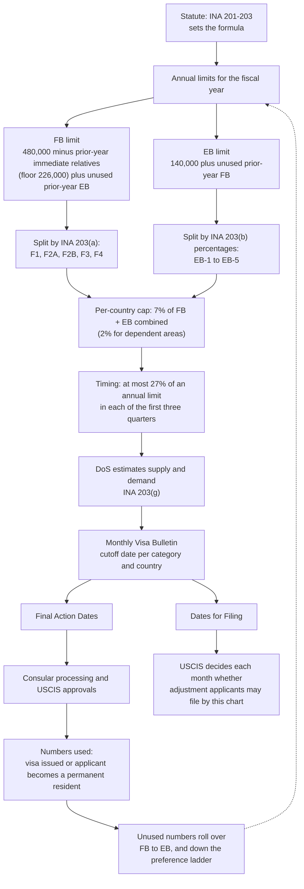

# How the State Department allocates immigrant visa numbers to FB and EB categories

**Short answer:** the State Department (DoS) does not divide visas by discretion. Congress fixed the formula in
INA §§ 201–203 (8 U.S.C. §§ 1151–1153). DoS computes each fiscal year's limits from it, then sets monthly
**cutoff dates** to keep use of each category's numbers within its limit. The cutoff dates in
`data/visa-priority-dates.csv` are the visible output of this process.

Diagrams are [Mermaid](https://mermaid.js.org/), which GitHub and VS Code render. Reports in this folder:

| File | Question |
|---|---|
| [`01-annual-limits.md`](./01-annual-limits.md) | How are the FB and EB annual limits computed, and why does the EB limit change each year? |
| [`02-category-split.md`](./02-category-split.md) | How is each limit divided among F1–F4 and EB-1 to EB-5, and where do unused numbers go? |
| [`03-country-quarter-caps-and-cutoffs.md`](./03-country-quarter-caps-and-cutoffs.md) | How do the 7% country cap, the quarterly limit and demand turn into the monthly bulletin? |

## The whole process

## What each step takes from the data

| Step | Set by | Changes how often |
|---|---|---|
| Formulas, percentages, 7% cap | Statute | Only when Congress amends the INA |
| Annual FB and EB limits | DoS, from the formula and prior-year usage | Every fiscal year |
| Category and country shares | DoS, from the formula | Every fiscal year |
| Cutoff dates | DoS Visa Office, from demand versus remaining numbers | Every month |
| Which chart USCIS uses | USCIS, after consulting DoS | Every month |

## How this connects to the other analyses

- **Why October jumps ([statement 2](../02-fiscal-year-and-quarter-jumps/README.md)):** a new fiscal year resets
  every category's numbers, and the 27% quarterly limit releases the remainder in July–September.
- **Why EB-3 can be ahead of EB-2 ([statement 3](../03-inversion-speed/README.md)):** each category has its own
  percentage and its own demand. Unused EB-1 numbers cascade to EB-2 and then to EB-3, never the other way.

## Evidence quality

The research ran five search angles, read 16 sources, and put 23 claims through three-vote verification. The
family split and the EB percentages were then checked against the statute text
([8 U.S.C. § 1153](https://www.law.cornell.edu/uscode/text/8/1153)).

- **Solid:** the FB and EB formulas, the EB percentages and cascade, the family base numbers, and the
  cutoff-setting authority in INA 203(g).
- **Medium:** the 27% quarterly limit and how the per-country cap works in practice. They rest on secondary
  sources (USCIS FAQ, law-firm and analyst pages) and were not matched to a specific INA subsection.
- **Not covered:** the diversity visa program, the immediate-relative count behind the FB formula, and recent
  policy and litigation (for example the October 2026 bulletin delay), which may change actual number usage
  but not the allocation formula.

## Sources

- [8 U.S.C. § 1153](https://www.law.cornell.edu/uscode/text/8/1153) (INA 203): preference splits and cascade.
- [USCIS: fiscal year 2023 employment-based adjustment of status FAQs](https://www.uscis.gov/green-card/green-card-processes-and-procedures/fiscal-year-2023-employment-based-adjustment-of-status-faqs)
- [Immigration Road: annual limit and cap](https://immigrationroad.com/visa-bulletin/immigrant-visa-annual-limit-and-cap.php)
- [Immigration Analytics: the missing October visa bulletin](https://immigration-analytics.com/2026/09/25/the-missing-october-visa-bulletin-three-restrictions-one-court-fight-and-where-the-visa-numbers-go/)
- [Larrabee: changes to the visa bulletin and adjustment of status filing](https://www.larrabee.com/immigration-law-faqs/changes-to-the-visa-bulletin-and-the-ability-to-file-adjustment-of-status-applications-2/)
- [Berardi Immigration Law: Final Action Dates vs Dates for Filing](https://berardiimmigrationlaw.com/the-visa-bulletin-final-action-dates-vs-dates-for-filing/)
